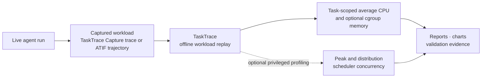

# TaskTrace

Agentic workloads spend significant time executing tools such as shell
commands, builds, tests, and file operations. TaskTrace replays the recorded
tool activity from an agent run without running model inference again, enabling
repeatable comparisons across CPUs, machines, core allocations, and runtime
environments.

## Ways to Use This Tool

Use TaskTrace to:

1. **Replay recorded agent workloads:** Re-execute supported tool actions without calling the model again.

2. **Compare infrastructure:** Replay the same recorded workload across CPUs, core counts, NUMA placements, and runtime settings to measure how each variable affects CPU demand and replay-command time.

3. **Measure resource requirements:** Capture task-scoped CPU use, with optional profiling for cgroup memory, peak CPU concurrency, process activity, and hardware counters.

4. **Run scaling experiments:** Execute sealed workloads sequentially, concurrently, or as ordered waves to study system behavior under load.

## Overview

### Where This Fits

TaskTrace is the replay-and-measurement component of the agentic-workload
measurement workflow:



TaskTrace Capture, Terminal-Bench, and other compatible agent-run artifacts
provide the workload. TaskTrace re-executes it in a controlled environment and
measures resource use; it does not rerun the original task verifier.

ATIF, the
[Agent Trajectory Interchange Format](https://harborframework.com/docs/trajectory-format),
is the JSON format Harbor uses to record an agent run, including every tool call
and its result.

## Supported Configurations

| Input or workload                       | What TaskTrace does                                                                                  |
| --------------------------------------- | ---------------------------------------------------------------------------------------------------- |
| Transcript JSONL                        | Re-executes supported recorded actions with optional container profiling.                            |
| Finalized TaskTrace Capture shell trace | Re-executes finalized top-level shell actions using `recorded`, `llm-gaps`, or `unpaced` pacing.     |
| Supported ATIF trajectory               | Re-executes supported ATIF tool calls with optional profiling in Docker or Enroot.                   |
| Arbitrary container command             | Measures a command in a disposable or existing Docker container, or through Enroot (wall time only). |
| YAML task list or ordered wave          | Executes ATIF workloads sequentially, with bounded concurrency, or as ordered waves.                 |

## Prerequisites

TaskTrace is a native Linux executable (`tasktrace`) built from Rust. See
[Quick Start](#quick-start) and
[Development and Testing](#development-and-testing) for installation options.
Additional requirements depend on the runtime and measurements you use:

| Path        | Requirements                                             | Available measurements                                                                                 |
| ----------- | -------------------------------------------------------- | ------------------------------------------------------------------------------------------------------ |
| Replay only | No container runtime required.                           | Replay outcomes, wall time, and process CPU time where the input format provides it.                   |
| Docker      | Docker Engine with cgroup v2.                            | Task-scoped CPU, optional cgroup memory profiling, network controls, and optional scheduler profiling. |
| Enroot      | Enroot with a `.sqsh` image or existing named container. | Replay outcomes and wall time only.                                                                    |

Enroot profiles run `enroot start` with `ENROOT_MOUNT_HOME=no` so a site's home hook never
mounts the invoking user's home over the container's `/root`: the replay sees the image's own
`/root` dotfiles (SWE-bench images activate their conda env from `/root/.bashrc`) and never
runs the user's personal shell setup inside the task. The container's environment is unaffected.

For Docker setup, follow the
[official installation instructions](https://docs.docker.com/engine/install/).
Note that Docker daemon access is root-equivalent on most hosts.

Advanced scheduler profiling requires `perf` or BCC/eBPF and additional host
permissions. See [Optional Profiling](#optional-profiling).

All reported CPU counts are logical CPUs unless explicitly stated otherwise.

## Quick Start

This example replays a bundled transcript without calling a model. It requires
Linux, [`uv`](https://docs.astral.sh/uv/), and Rust and Cargo 1.75 or newer. It
does not require Docker or privileged profiling.

```bash
git clone https://github.com/NVIDIA/exemplar-performance.git
cd exemplar-performance/inference/tools/tasktrace

uv run tasktrace --help
RUN="$(mktemp -d /tmp/tasktrace-quickstart.XXXXXX)"

uv run tasktrace replay transcript \
  offline_replayer/examples/productivity_calendar.jsonl \
  --workspace "$RUN/workspace" \
  --output-dir "$RUN/output"

uv run python -m json.tool "$RUN/output/replay_report.json"
```

On first use, `uv run tasktrace` builds the native Rust executable through
Maturin; later invocations reuse that build.

Because the bundled transcript contains a single task with recorded tool calls,
TaskTrace selects it automatically and maps its recorded `agent_workspace`
paths into the new workspace. The report contains action outcomes, wall time,
and process CPU time; it does not rerun the original task verifier.

## Usage Examples

Choose a command based on the workload you already have:

| Starting point                                   | Command                                     |
| ------------------------------------------------ | ------------------------------------------- |
| Transcript JSONL                                 | `tasktrace replay transcript`               |
| Transcript that also needs container measurement | `tasktrace profile transcript`              |
| Finalized TaskTrace Capture trace, replay only   | `tasktrace replay trace`                    |
| Finalized TaskTrace Capture trace                | `tasktrace profile trace`                   |
| Finalized capture trace in the current container | `tasktrace profile trace --runtime current` |
| ATIF trajectory, replay only                     | `tasktrace replay atif`                     |
| ATIF trajectory with container measurement       | `tasktrace profile atif`                    |
| ATIF trajectory in the current container         | `tasktrace profile atif --runtime current`  |
| Arbitrary command in a task container            | `tasktrace profile container`               |
| YAML collection of ATIF workloads                | `tasktrace run`                             |

### Transcript Replay

Transcript replay accepts JSONL records whose `answer` field contains recorded
tool calls.

TaskTrace selects one task from the transcript and executes its supported
actions in a new or empty workspace. Use `--task-id` when the file contains
multiple tasks. When the selected task contains multiple trials, use
`--trial-name` to replay one trial; otherwise, actions from all matching trials
are replayed in source order.

The report includes per-action and total wall and process CPU time. CPU time is
summed across the replayer and completed children, so it can exceed wall time
when processes run in parallel.

#### Supported Transcript Tools

| Recorded tool                  | Replay behavior                                                                           |
| ------------------------------ | ----------------------------------------------------------------------------------------- |
| `exec`, `bash`, `shell`        | Runs the recorded command using `/bin/bash -c`.                                           |
| `write`                        | Writes the captured content into the replay workspace.                                    |
| `read`                         | Reads a replay-workspace file using the recorded line `offset` and `limit`, when present. |
| Other tools, such as `browser` | Records the action as unsupported and skips it; `--strict` stops the replay instead.      |

File paths beneath a captured `agent_workspace` directory are automatically
mapped into the new replay workspace. Use `--source-workspace` to map a
different captured workspace prefix or to rewrite that prefix inside recorded
shell commands.

Transcript replay writes normalized actions to `extracted_actions.jsonl`,
results to `replay_report.json`, and replayed file changes to `<workspace>/`.

### Profiling a Finalized Capture Trace

A finalized `tasktrace_shell_commands.jsonl` contains the top-level shell
actions from a TaskTrace Capture run. Per-command streams that have not been
finalized into this trace format are rejected. By default, recorded start times
are preserved so background work can continue between agent actions.

A trace written without its timings
(`tasktrace-capture --trajectory-timings omit`) has no start times to preserve,
so it replays only with `--pacing unpaced`. Each of its actions records the LLM
call it followed. When an LLM-side replay runs alongside,
`replay trace --loop-sync-dir <dir>` (or `profile trace --loop-order` with
Enroot or `--runtime current`) keeps the agent loop's order: each action waits
until the call it followed has been replayed, and the two sides hand off through
files in that directory.

Use a prepared task image to replay the trace and measure its task-scoped
resource use:

```bash
uv run tasktrace profile trace \
  /path/to/tasktrace_shell_commands.jsonl \
  --image "<prepared-task-image>" \
  --cpu-limit 2 \
  --allocated-cpus 2 \
  --pacing recorded \
  --output-dir /tmp/tasktrace-capture-trace-profile
```

The native replay controller binary is mounted into the container read-only,
so the task image does not need Python or TaskTrace installed. The image must
match the host CPU architecture and support the Linux binary.

`--cpu-limit` sets the Docker CPU quota for the replay. To reproduce the
original quota, use the same value as the original task. `--allocated-cpus`
supplies the denominator used for utilization reporting; it does not restrict
CPU access. Use `--cpuset-cpus` instead when the replay should be restricted to
specific logical CPUs.

`pipeline_report.json` combines trace provenance, replay outcomes, image
identity, and task-scoped CPU measurements. See
[Optional Profiling](#optional-profiling) for host sampling and peak
concurrency.

### ATIF Trajectory Profiling

TaskTrace accepts ATIF v1.x `trajectory.json` files, including supported
Terminal-Bench run artifacts.

| Recorded tool                                  | Replay behavior                                           |
| ---------------------------------------------- | --------------------------------------------------------- |
| `exec_command`                                 | Executes the recorded shell command.                      |
| `write_stdin`                                  | Sends input to a recorded interactive command session.    |
| `apply_patch`                                  | Applies the recorded patch within permitted paths.        |
| `update_plan`, `web_search_call`, `view_image` | Retains the action as metadata without executing it.      |
| Other tools                                    | Rejects the trajectory instead of silently dropping work. |

For `apply_patch`, writes are restricted to the replay workspace and `/tmp` by
default. Use `--patch-root` to specify permitted scratch locations outside the
workspace.

TaskTrace also supports trajectories marked with
`agent.extra.original_format: mini-swe-agent-1.1`. For these trajectories,
recorded `bash` calls are replayed through the supported shell-command path.
Unmarked `bash` calls in generic ATIF trajectories are rejected.

Codex exec (`agent.name: codex`, `agent.extra.originator: codex_exec`) and
Claude Code ATIF replay and profiling are not supported in release 26.10.
Trajectories containing nested Codex exec or Claude Code actions are also rejected.
Generic ATIF tool calls and the mini-swe-agent wrapper described above remain supported.

Recorded shell, login, working-directory, and TTY options are honored. Commands
use the environment established by the selected image or runtime, including
profile-level `--env` overrides; per-action ATIF environment maps are not
applied.
`tty: true` uses an 80×24 pseudo-terminal with merged stdout/stderr and terminal
handling of stdin, Ctrl-C, and EOF. Background sessions continue between actions
and are cleaned up when replay finishes. Known planning and display calls are
retained as metadata; unsupported executable tools fail preflight.

#### Pacing and Output Capture

| Pacing mode | Behavior                                                                               |
| ----------- | -------------------------------------------------------------------------------------- |
| `recorded`  | Starts each action at its recorded offset on the original timeline (default).          |
| `llm-gaps`  | Preserves recorded gaps between tool completion and the next agent action.             |
| `unpaced`   | Removes recorded idle time and replays actions as quickly as their dependencies allow. |

Use `unpaced` when comparing pure tool-execution CPU work across
systems:

```bash
uv run tasktrace profile atif \
  /path/to/trajectory.json \
  --image "<prepared-task-image>" \
  --cpu-limit 1 \
  --allocated-cpus 1 \
  --pacing unpaced \
  --capture-action-outputs \
  --timeout-sec 300 \
  --output-dir /tmp/atif-trajectory-profile
```

The report compares action states and return codes when available; it does not
prove byte-identical filesystem or output state. `--capture-action-outputs`
saves foreground output under `<output-dir>/replay/action_outputs/`.
Interactive sessions retain their logs automatically.

The task image follows the same binary and architecture requirements described
for [finalized capture traces](#profiling-a-finalized-capture-trace).

#### Pinning the Recording Environment

Docker and Enroot profiles accept `--env NAME=VALUE` assignments; repeat the
option to set multiple variables. Pass a bare `--env NAME` to remove a
variable. Reports retain variable names and value hashes, not raw values. Do
not pass credentials this way.

### End-to-End Transcript Profiling

`tasktrace profile transcript` combines transcript extraction, replay,
and container measurement in one command:

```bash
uv run tasktrace profile transcript /path/to/transcript.jsonl \
  --task-id "<task-id>" \
  --trial-name "<trial-name>" \
  --image "<prepared-task-image>" \
  --cpuset-cpus 0-3 \
  --strace-mode none \
  --output-dir /tmp/transcript-profile
```

The command validates supported tools before starting the container.
`--allow-unsupported` permits a deliberately partial replay.

Outputs include the combined `pipeline_report.json`, per-action replay report,
replay workspace, and task-scoped container profile.

Use `--initial-workspace` when the task requires captured input files or
repository state. For PinchBench transcripts, `--pinchbench-skill-dir` can
stage the selected task's declared `workspace_files`.

Commands that failed during the recorded run are replayed and reported as
failed actions. They do not stop later actions unless you run
`replay transcript` directly with `--strict`.

### Container Command Profiler

Use `profile container` to measure one command inside a prepared task image
without replaying a trajectory:

```bash
uv run tasktrace profile container \
  --image "<prepared-task-image>" \
  --cpuset-cpus 0-7 \
  --workdir /workdir \
  --command 'make -j8 V=1' \
  --strace-mode none \
  --output-dir /tmp/container-command-profile
```

Use `--cpu-limit N --allocated-cpus N` instead when reproducing a Docker CPU
quota. Use `--cpuset-cpus` when CPU affinity is part of the experiment.

`--strace-mode execve` records process launches; `process` records broader
lifecycle events. Both require `strace` in the image and add overhead. Use
`none` for an untraced CPU baseline.

An already-running Docker container can also be measured:

```bash
uv run tasktrace profile container \
  --container "<running-container-name-or-id>" \
  --allocated-cpus 8 \
  --workdir /workdir \
  --command 'make -j8 V=1' \
  --strace-mode none \
  --output-dir /tmp/existing-container-profile
```

Existing-container mode does not stop, remove, restart, or reconfigure the
container. Treat the result as diagnostic: its cgroup measurement includes any
other work running inside the same container. Use disposable `--image` mode
for controlled comparisons.

## Runtime Options

### Profiling Inside the Current Container

Use `--runtime current` when TaskTrace is already running inside the task
container and should run the ATIF or finalized-trace replay inside that same
container. TaskTrace does not create a nested Docker or Enroot container in this
mode. `tasktrace profile trace` takes the same flags as the ATIF example below.

```bash
uv run tasktrace profile atif /inputs/trajectory.json \
  --runtime current \
  --current-container-exclusive \
  --allocated-cpus 8 \
  --pacing unpaced \
  --workdir /workspace \
  --output-dir /results
```

The current container must be a fresh, single-task sandbox with readable cgroup
v2 CPU accounting. `--current-container-exclusive` asserts that the container
is dedicated to this replay. TaskTrace checks that the cgroup and allocation
remain stable, looks for unrelated or surviving processes, and marks the CPU
measurement invalid when it cannot establish the required scope. Processes too
short-lived to attribute are listed under
`transient_unattributed_processes_during` and do not invalidate it.

The system that created the container remains responsible for the image, CPU
allocation, namespaces, network, and initial filesystem. Current mode does not
accept `--image` and cannot enforce `--cpu-limit` or `--cpuset-cpus`.
`--allocated-cpus` supplies only the denominator for utilization reporting; it
does not create or enforce an allocation.

Current mode reports wall time, cgroup CPU time, average logical-core use,
observed allocation, and throttling. Optional `strace` process tracing is
available when `strace` is installed. Memory, scheduler-concurrency, hardware,
`/proc/stat`, profile-set, coordinated, verification-command, and TaskTrace
network-policy profiling options are unsupported. Retain the container
deployment manifest and immutable image digest externally because TaskTrace
cannot establish portable image identity from inside the current container.

### Network Policies

Disposable Docker replays support three network modes:

| Mode         | Sandbox behavior                                                                          | Typical use                                                         |
| ------------ | ----------------------------------------------------------------------------------------- | ------------------------------------------------------------------- |
| `public`     | Uses normal Docker networking (default).                                                  | Workloads that require unrestricted external access.                |
| `no-network` | Runs with Docker networking disabled.                                                     | Comparisons that should not depend on external services.            |
| `allowlist`  | Uses a private Docker network and permits access only to specified hosts through a proxy. | Workloads that require a small, known set of external dependencies. |

Select a policy with `--network-policy`. For an allowlist, repeat
`--allowed-host` for each permitted hostname:

```bash
--network-policy allowlist \
  --allowed-host example.com \
  --allowed-host files.example.com
```

Matching is exact and case-insensitive; subdomains must be listed separately.
An empty allowlist behaves like `no-network`. The proxy runs outside the task
cgroup, so its CPU and memory are excluded. Use the same policy for comparisons.
Allowlisting improves reproducibility but is not a hostile-code security
boundary.

## Output Folder Structure

Replay and profile commands produce structured JSON reports alongside optional
raw evidence and rendered charts:

| Workflow                                                          | Primary outputs                                                                |
| ----------------------------------------------------------------- | ------------------------------------------------------------------------------ |
| Replay                                                            | Action outcomes and timing in `replay_report.json`.                            |
| Profile                                                           | A combined `pipeline_report.json` and runtime-specific measurement artifacts.  |
| Coordinated profile (`--profile-set` or `--coordinated-baseline`) | An evidence bundle, view model, and rendered HTML or SVG views when requested. |
| YAML run                                                          | Per-attempt reports plus `results.csv` and `summary.json`.                     |

A typical ATIF or finalized-trace profile produced by the standard container
controller uses this layout:

```text
<output-dir>/
├── pipeline_report.json         # start here: joined replay and profile summary
├── replay/
│   ├── replay_report.json       # per-action replay status and timing
│   ├── action_outputs/          # optional captured command output
│   └── session_logs/            # interactive sessions only
└── container_profile/
    ├── profile_report.json      # detailed cgroup CPU and validity evidence
    ├── command.stdout.txt       # replay-controller standard output
    ├── command.stderr.txt       # replay-controller standard error
    └── ...                       # profiler-specific raw evidence
```

| What do I need?              | Start with                                      |
| ---------------------------- | ----------------------------------------------- |
| Overall result for one trial | `pipeline_report.json`                          |
| CPU and wall-time summary    | `container_cpu` in `pipeline_report.json`       |
| Per-action replay result     | `replay/replay_report.json`                     |
| Captured command text        | `replay/action_outputs/`, when enabled          |
| Raw CPU evidence             | `container_profile/profile_report.json`         |
| Overview of many trials      | `results.csv` and `summary.json` for a YAML run |

Use `pipeline_report.json` as the entry point for a single trial. It joins the
replay summary, task-scoped cgroup CPU measurement, runtime and image identity,
validity gates, and references to supporting artifacts. Its
`container_cpu.wall_sec` is the CPU measurement window;
`replay_summary.wall_time_sec` is the narrower replay-command duration. A
`status` of `valid` means the replay measurement passed its validity gates; it
does not by itself prove official benchmark task correctness.

Use `replay_report.json` to inspect individual recorded actions, return codes,
timing, and source-versus-replay outcome comparisons. It is not a console
transcript. Per-action stdout and stderr are present only when action output
capture was enabled, in which case they are written under
`replay/action_outputs/`.

For CPU investigation, use `profile_report.json` to audit the raw cgroup
evidence behind the summary. Treat profiler-specific artifacts as diagnostic
when their own validity fields fail, even if the top-level cgroup measurement
remains valid.

### Reading `pipeline_report.json`

The principal result locations are:

| Result                          | JSON field                                                                                        |
| ------------------------------- | ------------------------------------------------------------------------------------------------- |
| Overall replay/profile status   | `status`, `profiling_valid`                                                                       |
| Replay-command duration         | `replay_summary.wall_time_sec`                                                                    |
| Recorded source interval        | `replay_summary.source_interval_sec`                                                              |
| Replayed and mismatched actions | `replay_summary`                                                                                  |
| CPU measurement duration        | `container_cpu.wall_sec`                                                                          |
| Task-scoped CPU consumed        | `container_cpu.usage_sec`                                                                         |
| Average logical cores           | `container_cpu.average_logical_cores_used` (`average_logical_cores` in coordinated evidence)      |
| CPU-measurement validity        | `container_cpu.valid_for_cpu_performance` and `profiling_valid`, when present                     |
| CPU throttling                  | `container_cpu.leaf_cpu.throttling_observed` and `container_cpu.ancestor_cpu.throttling_observed` |
| Enforced CPU capacity           | `container_cpu.enforced_logical_cpu_limit`                                                        |
| Validated peak/distribution     | `scheduler_concurrency` when available                                                            |

<details>
<summary>Example single-trial metrics</summary>

The following values are illustrative of a profile created with a coordinated
`--profile-set`. They show how to summarize one `pipeline_report.json`; they
are not a benchmark result or a fixed-core claim.

```text
Replay fidelity
  Recorded actions                 42
  Tool actions replayed         29/29
  Comparable outcomes matched   29/29
  Failed or timed-out actions       0

Timing
  Recorded source interval     129.509 s
  Replay-command wall time       3.710 s
  CPU measurement wall time      3.739 s

Task-scoped CPU
  Container CPU time            36.618 CPU-s
  Average logical cores          9.793
  CPU throttling observed           no
  Enforced logical-CPU limit      none
  Scheduler concurrency    unavailable

Validity
  Replay/profile status           valid
  CPU measurement valid             yes
  Official task correctness   not evaluated
```

</details>

A bounded-concurrency YAML run stores aggregate results at the root and each
attempt's complete profile beneath its task:

```text
<output-dir>/
├── results.csv                 # one row per task attempt
├── summary.json                # aggregate status and run/wave measurements
└── tasks/
    └── <task-id>/
        └── rep-0001/
            └── profile/
                ├── pipeline_report.json
                ├── replay/
                └── container_profile/
```

Ordered-wave runs additionally write `resolved-run.yaml` and organize attempt
profiles under
`waves/<wave-number>-<wave-id>/launch-<number>-<task-id>/profile/`. Unlike the
ATIF and finalized-trace layout above, transcript profiles place their
extracted actions and report under `replay/output/`. Exact raw artifacts vary
by runtime, controller implementation, and selected profilers. Use the paths,
checksums, and validity fields in `pipeline_report.json` to identify and verify
supporting evidence.

Available reporting commands include:

| Command                    | Purpose                                                                                     |
| -------------------------- | ------------------------------------------------------------------------------------------- |
| `report analyze-tb2`       | Aggregate completed Terminal-Bench profiles.                                                |
| `report render-batch`      | Combine validated scheduler-concurrency reports into charts and machine-readable summaries. |
| `report render-set`        | Render a repeatable collection defined by a report-set manifest.                            |
| `report resource-timeline` | Render CPU and memory evidence from a profile report.                                       |

`render-batch` accepts validated scheduler-concurrency reports produced by
either BCC or `perf`. It rejects reports with replay outcome mismatches or
invalid scheduler-to-cgroup validation. Keep the raw pipeline reports and
source trajectories; rendered output is not a substitute for them. Use
`report <command> --help` for complete options.

## Metrics Collected

TaskTrace uses task-scoped cgroup v2 counters for its primary Docker CPU
measurements:

```text
average_logical_cores_used = cpu_usage_sec / wall_sec
utilization_percent_of_allocation =
    100 * average_logical_cores_used / allocated_logical_cpus
```

These measurements answer different questions:

| Question                                      | Measurement                                                                      |
| --------------------------------------------- | -------------------------------------------------------------------------------- |
| How much CPU did the task consume?            | Cgroup CPU seconds.                                                              |
| How many logical CPUs did it use on average?  | `average_logical_cores_used`.                                                    |
| What fraction of its allocation did it use?   | Average logical cores divided by the allocation denominator.                     |
| How many logical CPUs could it run on?        | Effective cpuset or scheduler affinity. This is capacity, not usage.             |
| What was its exact peak simultaneous CPU use? | Validated scheduler-concurrency profiling.                                       |
| Was the host or allocation busy?              | Sampled `/proc/stat` context. This is not task-scoped usage or peak concurrency. |

A task can average one logical core while migrating across several CPU IDs.
A cpuset width or `make -j` value describes capacity or requested parallelism,
not observed use. All CPU counts are logical CPUs; physical-core analysis
requires CPU-topology and simultaneous-multithreading information.

## Optional Profiling

Most users need only Docker cgroup measurements, which report how much CPU a
task used on average. Use the other profilers only when you need host-level
context or exact peak CPU concurrency:

| What you need                                | Method                     | Additional requirement                                              |
| -------------------------------------------- | -------------------------- | ------------------------------------------------------------------- |
| Average CPU used by the task                 | Docker cgroup v2           | Docker access and cgroup v2.                                        |
| Activity elsewhere on the host or allocation | `/proc/stat`               | Readable `/proc/stat` and a fixed `--cpuset-cpus`.                  |
| Exact peak and distribution using `perf`     | `perf` scheduler backend   | A compatible `perf` binary and permission to collect switch events. |
| Exact peak and distribution using eBPF       | BCC/eBPF scheduler backend | BCC, kernel eBPF support, and root-capable execution.               |

TaskTrace classifies cgroup CPU, cgroup memory, and scheduler concurrency as
resource profilers; process tracing as software profiling; and PMU collection
as hardware profiling. Named profile sets select presets from these categories.

To measure exact peak concurrency, add `--scheduler-concurrency` to a
disposable Docker profile:

```bash
uv run tasktrace profile container \
  --image "<prepared-task-image>" \
  --cpuset-cpus 0-3 \
  --command 'make -j4 V=1' \
  --strace-mode none \
  --scheduler-concurrency \
  --scheduler-backend perf \
  --output-dir /tmp/scheduler-profile
```

The example selects `perf` explicitly because it generally requires fewer
privileges than BCC. The default backend is BCC, which requires the BCC library
and root-capable execution. The `perf` backend may still require elevated
permissions depending on host policy. See the
[kernel perf security documentation](https://docs.kernel.org/admin-guide/perf-security.html).

TaskTrace reports peak results only when scheduler data agrees with the cgroup
CPU measurement and the trace is complete. Invalid runs exit nonzero while
retaining diagnostic evidence.

Scheduler tracing adds overhead. Use untraced cgroup profiles for average-CPU
comparisons and report traced peak measurements separately. `/proc/stat`
provides host or allocation context, not task-scoped average or peak CPU.

`report compare-agentscry` provides an optional external process-trace
cross-check, not authoritative CPU measurement. See
[AgentScry privileged cross-check](docs/agentscry-cross-check.md).

## Repeatable Runs

The `run` command executes a collection of ATIF workloads described in YAML.
Choose the schema based on how the tasks should be scheduled:

| Schema             | Purpose                                                          |
| ------------------ | ---------------------------------------------------------------- |
| `tasktrace-run.v1` | Run tasks one at a time.                                         |
| `tasktrace-run.v2` | Run a limited number of tasks concurrently on a shared CPU pool. |
| `tasktrace-run.v3` | Run predefined groups of tasks at different CPU allocations.     |

### Bounded-Concurrency Runs

A v2 manifest limits how many task attempts run at the same time:

```yaml
schema_version: tasktrace-run.v2
output: /tmp/tasktrace-run
cpus: "20-23"
concurrency: 4
repetitions: 3

tasks:
  - id: task-a
    atif: /traces/task-a/trajectory.json
    image: task-a@sha256:<digest>
  - id: task-b
    atif: /traces/task-b/trajectory.json
    image: task-b@sha256:<digest>
```

```bash
uv run tasktrace run tasks.yaml
```

Each attempt receives a fresh Docker container and cgroup. All attempts share
the declared `cpus` pool, so `concurrency` counts running tasks—not CPU cores.
The run writes per-attempt evidence, `results.csv`, and `summary.json`.

### Ordered Allocation Waves

A v3 manifest runs ordered groups, called waves, at specific CPU allocations:

```yaml
schema_version: tasktrace-run.v3
output: /tmp/tasktrace-sweep
input_root: /workspace/tasktrace-inputs
defaults:
  runtime: docker
  pacing: llm-gaps
  network_policy: public
  profile_sets: [cpu-average]
  controller_runtime: rust-host-mount
  controller_cpus: "0-3"
  worker_cpus: "4-11"
  placement: round-robin-single-cpu
  action_timeout_sec: 900
tasks:
  - id: task-a
    atif: task-a/trajectory.json
    image: task-a@sha256:<digest>
  - id: task-b
    atif: task-b/trajectory.json
    image: task-b@sha256:<digest>
waves:
  - id: allocation-1
    allocation: 1
    repeat: 1
  - id: allocation-2
    allocation: 2
    repeat: 1
```

`input_root` is the base directory for relative trajectory paths.
`profile_sets` selects named profiler presets; Docker runs must include
`cpu-average`. `controller_runtime` identifies the controller implementation
and must be `rust-host-mount`. `controller_cpus` selects the CPUs for controller
work, while `worker_cpus` defines the worker pool and `placement` defines how
each task is assigned within that pool.

For allocation `N`, TaskTrace assigns tasks round-robin across the first `N`
CPUs listed in `worker_cpus`. All tasks in one wave are submitted together, and
the next wave waits for them to finish. In v3, `repeat` is an informational
label recorded in the wave metadata; unlike v2 `repetitions`, it does not
launch additional attempts. Declare another wave when another execution is
required.

TaskTrace writes the exact expanded plan to `resolved-run.yaml`, making the
experiment easier to inspect and repeat. Docker provides per-task CPU and
per-wave throughput metrics. CPU assignment does not guarantee exclusive
ownership, so use quiet or scheduler-isolated CPUs for comparisons. Run
`tasktrace run --help` for the full manifest contract.

## CLI Reference

Use `uv run tasktrace` from a checkout or `tasktrace` after a wheel
or Cargo install.

The CLI has four command groups:

| Command   | Responsibility                                                                                                                                          |
| --------- | ------------------------------------------------------------------------------------------------------------------------------------------------------- |
| `run`     | Execute declared ATIF tasks sequentially (`tasktrace-run.v1`), with bounded concurrency (`tasktrace-run.v2`), or as ordered waves (`tasktrace-run.v3`). |
| `profile` | Execute one replay or arbitrary command inside a measured container.                                                                                    |
| `replay`  | Interpret and execute one recorded input format without batch scheduling.                                                                               |
| `report`  | Consume pipeline reports and publish summaries, charts, and catalogs.                                                                                   |

Run `tasktrace --help` or `<command> --help` for the complete CLI reference.

## Frequently Asked Questions

### Which output file should I open first?

Open `pipeline_report.json` for the overall result of one profiled replay. Use
`replay/replay_report.json` when you need individual action outcomes, and use
the files under `container_profile/` when auditing the raw measurement
evidence. For a YAML run, start with `summary.json` or `results.csv`.

### Why are two wall-time values reported?

`replay_summary.wall_time_sec` measures the replay command itself.
`container_cpu.wall_sec` measures the enclosing CPU-accounting window and can
include a small amount of controller overhead. Use the latter with
`container_cpu.usage_sec` when calculating average logical cores.

### Does average logical-core use reveal peak concurrency?

No. Average logical cores are CPU seconds divided by wall time. Do not infer a
peak from that average, an allocation denominator, a cpuset width, or host-wide
CPU percentages. Report peak or distribution values only when validated
`scheduler_concurrency` evidence is present.

### Does a valid profile prove that the benchmark task is correct?

No. A valid profile means that replay and measurement validity gates passed.
Official task correctness is separate and requires the benchmark's verifier or
equivalent output validation.

### Why do some output directories contain different files?

Artifacts vary by input format, runtime, controller, selected profilers, and
enabled output capture. Use artifact paths and validity information in
`pipeline_report.json` to identify supporting evidence, and consult the output
trees above for the standard and YAML-run layouts.

## Development and Testing

Building from source requires Rust and Cargo 1.75 or newer. Python 3.10 or
newer, PyYAML, and pytest are required only for the differential test suite;
they are not runtime dependencies of the installed executable. The public
command always executes the Rust implementation; the Python source tree is
retained only as a differential-test oracle.

```bash
cargo build --release --locked

# Optional user-local installation.
cargo install --locked --path .

cargo test --release --locked
uv run --extra test python -m pytest -q
```

## Limitations

- Replay executes captured commands. Only replay trusted trajectories.
- Only documented tools are replayed. Unsupported-tool behavior depends on the
  input format and strictness settings; see
  [Supported Transcript Tools](#supported-transcript-tools) and
  [ATIF Trajectory Profiling](#atif-trajectory-profiling).
- Initial workspace state is restored only when `--initial-workspace` or the
  PinchBench-specific `--pinchbench-skill-dir` option is provided.
- Time-, network-, package-, and host-dependent commands may behave differently
  when replayed on another system.
- Replay measures tool execution, not model inference, and does not call the
  model again.
- Replay does not rerun the original task verifier. Recorded rewards and action
  outcomes provide provenance, not fresh correctness validation.
- Scheduler-concurrency results are reportable only after their scheduler
  runtime passes cgroup CPU validation. `/proc/stat` remains host or allocation
  context, not task-scoped peak CPU use.
- Native Enroot profiles report replay outcomes and wall time, but not
  task-scoped CPU, memory, or scheduler measurements.
